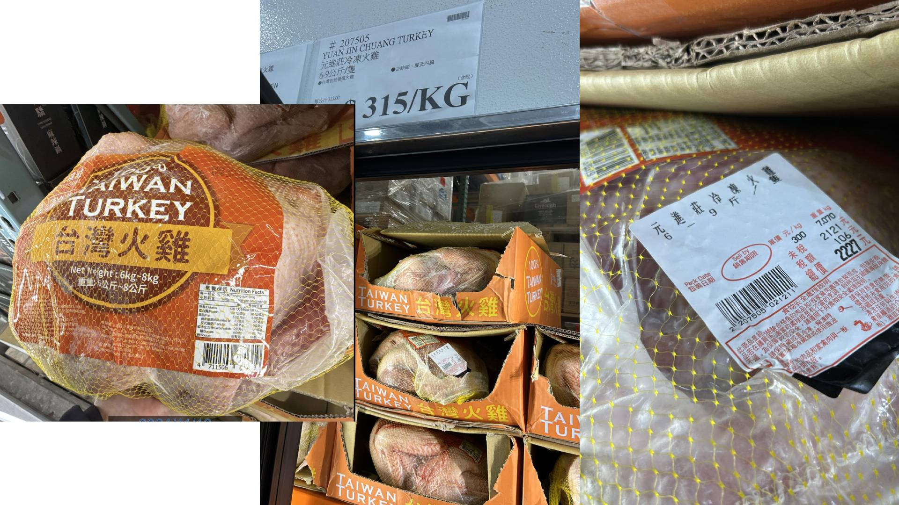
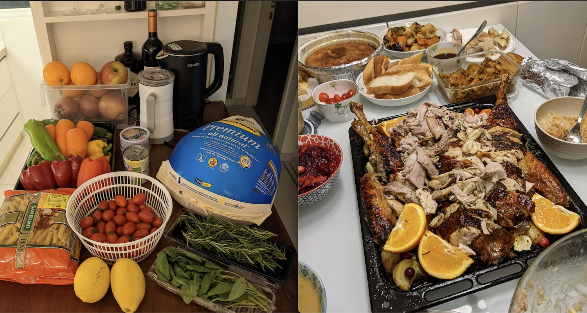
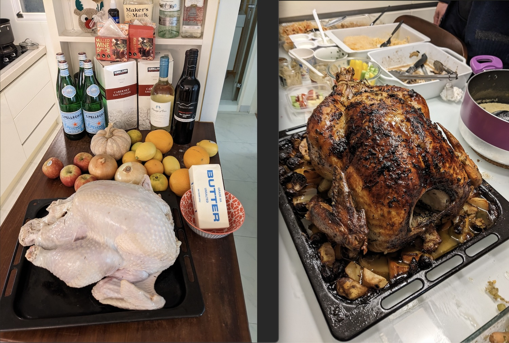

+++ 
draft = false
date = 2021-11-06T10:40:21+08:00
modified_date = 2026-11-25T11:40:00+08:00
title = "Where to Buy a whole Turkey in Taipei?"
description = ""
slug = "" 
tags = []
categories = []
externalLink = ""
series = []
+++

It is Thanksgiving / Christmas, and you are looking to cook a turkey in Taipei for your group of friends. You came at the right place! 

## Costco in Taipei

November 2026: Costco Taiwan lists  a Taiwan-raised, raw frozen turkey weighing **8–10 kg**. for  **NT$299/kg** on November 11, 2026. A whole bird costs **NT$2,392–2,990**, depending on its weight. [Costco product listing](https://www.costco.com.tw/Warehouse-Only/Food-Beverages/Frozen-Food/Yuan-Jin-Chuang-Frozen-Turkey-8-10-kg-Count/p/407505) ·

**Beitou** is the only Taipei branch where I found a dated sighting. A shopper reported seeing two turkeys there on November 19. As of November 25, I couldn’t confirm stock at Beitou, Neihu, or any New Taipei branch. [Shopper’s Facebook comment](https://www.facebook.com/groups/expatsintaiwan/posts/4348928935324391/?comment_id=4348965818654036)

Before you go, call **02-449-9909**,  [Costco Taiwan customer service](https://www.costco.com.tw/CustomerServiceContactUsPhoneWarehouse)

### Costco turkeys in previous years

In November 2024, Costco sold smaller Taiwanese turkeys, weighing 6–8 kg, for NT$315/kg. Here’s the one from that year.

Previous years, they had the [Frozen, pre-brine,  Butterballs Turkeys](https://www.butterball.com/products/whole-turkey/frozen) , which appeared around mid-October to December at all Costco locations in Taiwan. They weighed about 7kg (16lbs) and were imported from the US.

Here is a photo of the US Frozen Butterball Turkeys from the US (not the Taiwan one): 

Note: Costco did not have turkeys in 2022 and 2023.

## Fresh turkey delivered by a Tainan, Yunli, Chiayi farmers

You can find farmer through the ROC Turkey Association’s directory, which lists phone numbers for suppliers in **Yunlin, Chiayi, and Tainan**. Call one near you to ask about price and delivery dates.Ask a  a Chinese-speaking friend to help with the call if needed. [ROC Turkey Association supplier directory](https://turkey.org.tw/about-store/)

## From a farm (online)

Chiayi is home of the turkey rice (jirou fan). Many local farms can sell you from thei online shops or Line. I've listed a couple ones I've contacted: 

### Idol turkey on shopee
Believe it or not, we ordered the turkey on shopee in 2022 and 2023. And it turned out really nicely. 
You'll receive the turkey frozen, so account 3 days for defrosting it in your fridge + 3 days for brining it. 

Here the result: 

2000TWD for a ~8kg bird
2500TWD for a ~10kg bird

- Shop: https://shopee.tw/idol0402 

### Pasta & Co
Take home price : $5,990 NTD

Turkey (6/7KG) is brined in a special white wine brine for 96 hours then it is air dried in fridge for 72 hours, roasted and then crispied in the fryer.  The last date of pre-order (if quantity is still available) is 11/15 12PM

It seems to include a cake, mac and cheese and potatoes.

Order: https://www.facebook.com/share/p/1DkuVpVza7/

### Taiwan Turkey Store Food

I didn't try that one yet
- Shop: https://foodstore.qdm.tw/ 
- Facebook page: https://www.facebook.com/taiwanturkey

1900TWD + 200TWD delivery for 8kg (17lbs). They will send you the frozen turkey. 

### Turkey Chef (火雞總舖)
- Shop: https://shopee.tw/turkey_chef
- Facebook: https://www.facebook.com/TurkeyChef/

They have quite big turkey, 13kg (28lbs). But way too big for my oven.

## Thomas meat (in Taipei)

They seem to have options from 1200 to 2600 TWD for a 4.5kg cooked bird

- Shop: https://www.thomasmeat.com/index.php?Page=Search&Keyword=%E5%AD%A3%E7%AF%80%E9%99%90%E5%AE%9A&utm_medium=post&utm_source=fbpg&utm_campaign=turkey23_organic
- Facebook: https://www.facebook.com/thomasmeat

## Dimensions of a turkey by weight - Will the turkey fits inside my oven? 
If you are really lucky, your apartment in Taiwan will come with an oven integrated in the kitchen. 
And here come the question... will the turkey will fit in your oven? 
Turkeys vary in size and all the same, here some dimensions I found I hope will help you:

- 4kg – 22cm (w) x 30cm (L) x 15cm (h) 

- 7.4kg - 27cm (w) x 35cm (L) x 19 cm (h) 
- 7.5kg - 26cm (w) x 33cm (L) x 17cm (h)

- 10kg - 32cm (w) x 39cm (L) x 19cm (h)
- 10kg – 31cm (w) x 38cm (L) x 20cm (h) 

- 12.5kg - 30cm (w) x 41cm (L) x 20cm (h)   

- 13kg - 30cm (w) x 43cm (L) x 20cm (h)
- 13kg – 33cm (w) x 39cm (L) x 20cm (h)

If you are not lucky to have a big enough oven, it exists some really big portable oven like [this one from yamazaki](https://shop.yamasakitw.com/products/sk-5680m) but might be really expensive (maybe 25,000TWD). An other alternative is to book a cooking class that have those integrated ovens for a few hours and host your party there.

**Next read**:

🍤 [Restaurants I recommend after living 5 years in Taipei](/posts/taipei-restaurants/)

🚲 [Taiwan's amazing bike-sharing system](/posts/taiwan-youbike-bike-sharing/)

💰 [How to invest in ETFs and Stocks from Taiwan](/posts/investing-from-taiwan/)
